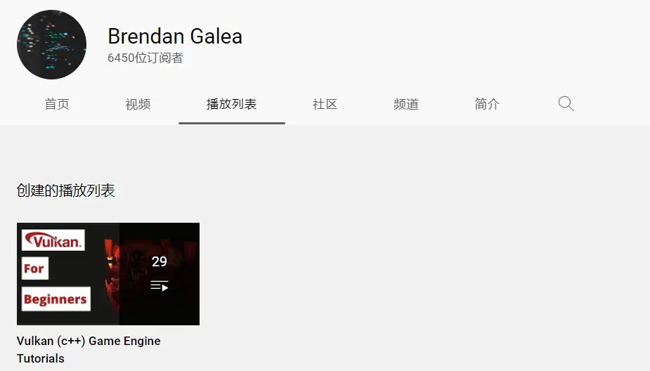
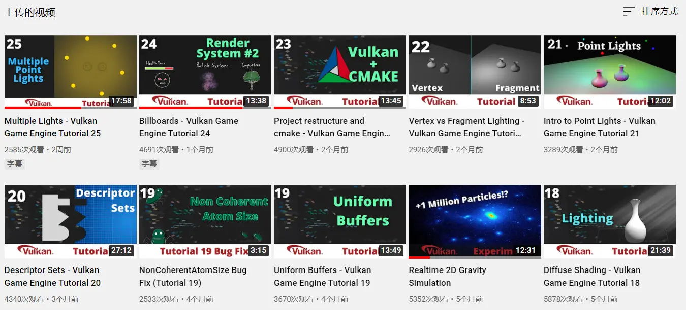

最近没事在刷油管涨姿势，然后又发现了一个宝藏视频系列。

<!--more-->

记得在过年前给大家留下了[音视频春节假期内卷指南](http://mp.weixin.qq.com/s?__biz=MzA4MjU1MDk3Ng==&mid=2451531381&idx=2&sn=c50258d9dda08654edf9434813dd11b5&chksm=886fcfdabf1846ccedbfda2b8d1b86e539b2cf0ce07c7f23f8633d57b84d54569e78acf985f0&scene=21#wechat_redirect)，里面就有着很多不错的视频教程，不知道大家过年的时候有没有看完，反正我是没看完。

现在又来一个新的视频合集推荐啦，就是它：

**Vulkan Game Engine 视频合集：**

链接地址如下：

https://www.youtube.com/c/BrendanGalea/playlists

顾名思义，这个视频教程就是教你通过 Vulkan 做一个游戏引擎。

不仅能学到 Vulkan 的知识还能实践到游戏引擎的开发中，目前这个系列还在连载中：

作者更新速度可能慢一点，但内容质量还是相当高的。

目前在 B 站上还没有人搬运过他的视频，有兴趣的也可以搬运一下，毕竟有些客观原因访问不了网站。

由于作者讲的是英文，像我们这样英语不好的，要在油管上把字幕打开才行，或者代码意思可以看懂也不需要翻译。

不过，作者也很贴心地把代码公布出来了，直接在 Github 上可以访问：

[https://github.com/blurrypiano/littleVulkanEngine](https://github.com/blurrypiano/littleVulkanEngine)

有空的同学可以 clone 下来学习一波。

**最重要的是**，一定要**收藏本篇文章**，因为**收藏了就等于学会了**。

另外，也推荐一下我之前用 Vulkan 写的 GPUImage 。

[用 Vulkan 渲染写一个 Android GPUImage](https://mp.weixin.qq.com/s?__biz=MzA4MjU1MDk3Ng==&mid=2451530625&idx=2&sn=5bbd2d16e734343febf42eab0e2c18b9&chksm=886fca2ebf18433842dbcb927938ea52c90c9d01530bb354128e52ef8bdf3ea13250aba91dca&scene=21#wechat_redirect)

公众号之前也发布过一些 Vulkan 的内容，欢迎阅读：

[Vulkan 在 FFmpeg 中的支持](https://mp.weixin.qq.com/s?__biz=MzA4MjU1MDk3Ng==&mid=2451531336&idx=1&sn=e988eb0f31a21ea0320885d33623bad9&chksm=886fcfe7bf1846f1883c73c50dc9f5f9aafc47241ee330c4ced253b493b2bb3f0ed7dfa22217&scene=21#wechat_redirect)

[【建议收藏】30 分钟入门 Vulkan (中文翻译版)](http://mp.weixin.qq.com/s?__biz=MzA4MjU1MDk3Ng==&mid=2451530038&idx=1&sn=11e50481a69f833ff67ac9f334f60974&chksm=886fc899bf18418f1d550ed248bbe70ae5770488fcfeede4c33d4fac80ff58de3371435e4305&scene=21#wechat_redirect)
